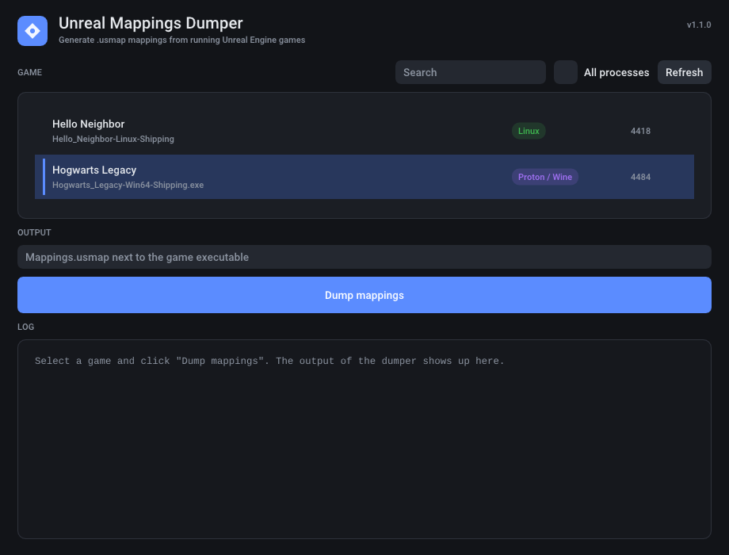

# UnrealMappingsDumper

[](https://github.com/mcbabel/UnrealMappingsDumper/actions/workflows/build.yml)

Generates `.usmap` mappings files for Unreal Engine games. Mappings are needed by tools like [FModel](https://fmodel.app), [CUE4Parse](https://github.com/FabianFG/CUE4Parse), UAssetGUI/UAssetAPI and UE4SS to read the assets of games that are cooked with unversioned properties, which is the case for almost every UE5 game.

Be sure to check the [Mappings Archive](https://github.com/OutTheShade/Unreal-Mappings-Archive) if the mappings for your game have already been dumped before. If you dump mappings for a game that isn't in the archive yet, uploading them there is encouraged.

**Platforms:** Windows and Linux are both officially supported, including Windows games running under Steam Proton, Wine, Lutris or Bottles.



## Features

- Simple window: start the program, pick your game, click **Dump mappings**. Running games are detected automatically.
- Nothing is injected into the game: the dumper reads the game's memory from outside. This works for Windows games, native Linux games and Proton/Wine games alike, and Wine isn't needed on Linux.
- Works on UE 4.25 up to the latest UE5 releases, including games built with `UE_FNAME_OUTLINE_NUMBER` (e.g. Fortnite) and the newer, smaller `FField` layout of recent UE5 versions.
- No hardcoded game specific offsets needed: GObjects, the name pool and all member offsets (`UObject`, `UStruct`, `FField`, `FProperty`, `UEnum`) are detected and validated at runtime. Signatures are only a first guess, everything is double checked before it's used.
- Writes the current usmap format (version 4, `ExplicitEnumValues`): long names, enums with more than 255 entries and enums with non sequential values are stored correctly. Also supports `OptionalProperty`, `Utf8StrProperty`, `AnsiStrProperty` and game specific property classes.
- Finds the AES key of games with encrypted pak files, which FModel and CUE4Parse need to open them, and checks it against the game's `.pak` and `.utoc` files.
- Everything is logged to `UnrealMappingsDumper.log`, which makes it easy to report problems.
- Also usable from the command line, and the classic dll can still be injected for games that need it.

## Download

Download the latest release from [Releases](https://github.com/mcbabel/UnrealMappingsDumper/releases):

| Package | Contents |
| --- | --- |
| `UnrealMappingsDumper-*-windows.zip` | `UnrealMappingsDumper.exe`, and `injection/` with the dll and the injector |
| `UnrealMappingsDumper-*-linux-x86_64.tar.gz` | `unreal-mappings-dumper`, and `proton-injection/` with the dll, the injector and `inject-linux.sh` |

You only need `UnrealMappingsDumper.exe` on Windows and `unreal-mappings-dumper` on Linux. The injection folders are an alternative for special cases, see [Alternative: injecting the dll](#alternative-injecting-the-dll).

Builds of every commit are also available as artifacts of the [Build workflow](https://github.com/mcbabel/UnrealMappingsDumper/actions/workflows/build.yml).

**UnrealMappingsDumper is not responsible for any bans. Don't use it on games with anti cheat, or at least take the proper precautions.**

## Usage

1. Start the game and wait until you're in the main menu, so all classes are loaded.
2. Start UnrealMappingsDumper:
   - **Windows:** double click `UnrealMappingsDumper.exe`.
   - **Linux:** double click `unreal-mappings-dumper` in your file manager, or run `./unreal-mappings-dumper` in a terminal.
3. Pick your game in the list. If only one game is running it's selected already. The badge shows whether it's a Windows, Proton/Wine or native Linux game.
4. Click **Dump mappings**. When it's done, **Open folder** shows the written `Mappings.usmap`.

### Finding the AES key

Many games encrypt their pak files. To open them in FModel or other tools you need the game's AES key. Select the game and click **Find AES key**:

- The dumper searches the game's code for the key and checks every key it finds against the game's `.pak` and `.utoc` files, so a key shown as found is the right one.
- Keys for pak files that are only unlocked later (dynamic keys, shown with their GUID) are searched in the game's memory. Some of them are only loaded after you reached a certain point in the game.
- If the pak files can't be found or none of them has an encrypted index, the keys can't be checked and are shown as possible keys.
- If the pak files aren't encrypted at all, it tells you that no key is needed.

In FModel, enter the main key under **Directory → AES** (with the `0x`), and the dynamic keys next to their GUID.

### Permissions on Linux

Linux only lets a program read the memory of another program with extra permission. If it's missing, the window says so and offers two options:

- **Allow permanently** asks for your password once and gives `unreal-mappings-dumper` the permission (`setcap cap_sys_ptrace=eip`). This only works if the file is on a Linux file system (e.g. inside your home directory), not on NTFS or FAT drives.
- **Ask every time** asks for your password for every dump instead.

### Permissions on Windows

Usually nothing is needed. If Windows refuses to let the dumper read a game, the window offers to restart it as administrator.

### Command line

Started with arguments, the same programs work on the command line:

```bash
sudo ./unreal-mappings-dumper              # Linux, dumps the only running game
sudo ./unreal-mappings-dumper MyGame       # pick a game by (part of) its name
UnrealMappingsDumper.exe --cli MyGame      # Windows
```

| Option | |
| --- | --- |
| `--pid <pid>` | Dump this process |
| `--output <file>` | Where to write the mappings, defaults to `Mappings.usmap` next to the game executable |
| `--list` | List the processes that can be dumped |
| `--aes` | Find the AES key instead of dumping mappings |
| `--paks <dir>` | The pak files to check the AES key with, found automatically next to the game if not set |
| `--cli` | Use the command line even without other options |
| `--gui` | Open the window even when started from a terminal as root |

With `--aes` the exit code is 0 if a key was found and verified (or no key is needed), 3 if only possible keys were found and 1 if nothing was found.

On Linux, `sudo` can be skipped after allowing it once with `sudo setcap cap_sys_ptrace=eip ./unreal-mappings-dumper`. When run with sudo, the written files are given back to your user.

### Output

- `Mappings.usmap` - the mappings
- `UnrealMappingsDumper.log` - everything the dumper did

Both are written next to the game executable (`<Project>/Binaries/Win64/` or `<Project>/Binaries/Linux/`), or into the current directory if that folder isn't writable. Under Proton the game folder is in your Steam library, e.g. `~/.local/share/Steam/steamapps/common/<Game>/<Project>/Binaries/Win64/`. The window shows the path and can open the folder.

## Alternative: injecting the dll

The classic way of loading `UnrealMappingsDumper.dll` into the game still works. It's only needed for special cases, for example games with a modified name pool, where the dll can fall back to calling the game's own `FName::ToString`.

**Windows:** run `injection/UnrealMappingsInjector.exe` while the game is running. It finds the `*-Win64-Shipping.exe` process by itself, takes a name (`UnrealMappingsInjector.exe MyGame`) or `--pid 1234`, and `--list` shows all processes. Any other dll injector works too. A message box shows where the files were written to; if the game folder isn't writable, the dll uses its own folder and then `%TEMP%\UnrealMappingsDumper`.

**Linux (Proton/Wine):** run `proton-injection/inject-linux.sh` as your normal user while the game is running. It finds the game, reuses the Wine/Proton build and the environment the game is running with and runs the injector inside the game's prefix. It also takes a part of the game's name or `--pid <linux pid>`.

- It needs `bash` and, for Proton, `nsenter` from util-linux, which is installed on every common distribution.
- Newer Proton versions run games inside the Steam Linux Runtime container, Flatpak Steam runs them inside its sandbox. The script detects that and runs the injector inside the game's container. The dll and the injector must be visible inside the container: if the script says they aren't, put them into your home directory or into the game's folder.

The mappings are written uncompressed, which every tool supports. If `oo2core_9_win64.dll` is loaded by the game or placed next to the dll, Oodle compression can be enabled in `dllmain.cpp`.

## Troubleshooting

| Problem | Solution |
| --- | --- |
| "Could not find GObjects" / "Could not find FName::ToString or the name pool" | The game might be too old (UE < 4.23), use a modified engine, or encrypt its names. On Linux, try injecting the dll into the Proton version, it can call the game's own `FName::ToString`. Open an issue with the log file. |
| "Not allowed to read the memory of process" (Linux) | Run the native dumper with sudo, or allow it once with `sudo setcap cap_sys_ptrace=eip ./unreal-mappings-dumper`. |
| Nothing happens after injecting | Check `UnrealMappingsDumper.log` next to the game executable. Make sure you injected into `*-Win64-Shipping.exe` and not into the launcher. |
| "Process is a 32 bit process" / "Platform mismatch" | The game is 32 bit. Unreal Engine games that need mappings are 64 bit only, 32 bit isn't supported. |
| The usmap is very small / classes are missing | Dump later, once the game has fully loaded (main menu or in game). |
| The window doesn't open on Linux | The window needs X11 or XWayland (included in KDE, GNOME and most other desktops). The command line works without it. |
| The game crashes or closes on injection | Most likely anti cheat or anti tamper protection. The dumper itself catches its own errors, check the log. |
| `LoadLibrary failed` | The dll path is wrong, or the dll was blocked by Windows (right click → Properties → Unblock). |

When reporting a problem, please attach `UnrealMappingsDumper.log`, the game name and its engine version, and a download link if the game is free.

## Building

Everything is C++23. The window uses [Dear ImGui](https://github.com/ocornut/imgui) and, on Linux, [GLFW](https://github.com/glfw/glfw), both are downloaded automatically by CMake. Only 64 bit builds are supported.

### Windows

- **Visual Studio 2022**: open the folder as a CMake project, this builds `UnrealMappingsDumper.exe`, the dll, the injector and the tests. `UnrealMappingsDumper.sln` only builds the dll.
- **CMake**:

  ```
  cmake -S . -B build -A x64
  cmake --build build --config Release
  ctest --test-dir build -C Release
  ```

### Linux

The native dumper, the X11 headers are only needed for the window:

```bash
sudo apt install cmake g++ git libx11-dev libxrandr-dev libxinerama-dev libxcursor-dev libxi-dev    # Debian/Ubuntu, g++ 13 or newer
sudo dnf install cmake gcc-c++ git libX11-devel libXrandr-devel libXinerama-devel libXcursor-devel libXi-devel    # Fedora
sudo pacman -S cmake gcc git libx11 libxrandr libxinerama libxcursor libxi    # Arch

cmake -S . -B build -DCMAKE_BUILD_TYPE=Release
cmake --build build
ctest --test-dir build
```

The output is `build/unreal-mappings-dumper`. `-DUMD_BUILD_GUI=OFF` builds it without the window.

The Windows version can be cross compiled with MinGW-w64, the tests then run through Wine:

```bash
sudo apt install cmake g++-mingw-w64-x86-64-posix wine64    # Debian/Ubuntu
sudo dnf install cmake mingw64-gcc-c++ wine                 # Fedora
sudo pacman -S cmake mingw-w64-gcc wine                     # Arch

cmake -S . -B build-windows -DCMAKE_BUILD_TYPE=Release -DCMAKE_TOOLCHAIN_FILE=cmake/mingw-w64-x86_64.cmake
cmake --build build-windows
ctest --test-dir build-windows
```

### Tests

`Tests/FakeEngineTest.cpp` builds a fake engine in memory (GObjects, name pool, classes, structs, enums and properties) in several layouts that match different engine versions, runs the dumper on it and parses the resulting usmap again. The `aes` test writes encrypted `.pak` and `.utoc` files and checks that the key registered by the fake game's code and a dynamic key in its memory are found. On Linux the fake engine runs in a child process that is dumped from outside, like a real game. CI additionally dumps running fake games with the same tools that are used for real games: `UnrealMappingsDumper.exe` on Windows and under Wine, the native Linux dumper against a native and a Wine game, and the injected dll on Windows and through Wine.

## Contributing

The engine layout lives in `unrealTypes.h`, the per version defaults and signatures in `unrealVersion.h`, and the runtime detection in `unrealVersion.cpp`. All of it reads memory through `memory.h`, which has an in-process backend for the dll and backends that read another process on Windows and Linux (`Platform/`). The window lives in `Gui/` and runs the command line version of itself for every dump. The AES key search is in `aeskey.cpp`, it decodes the instructions that store the key and checks the keys with the game's pak and utoc files. If a game needs special handling, add a version struct in `unrealVersion.h` and select it in `InitEngine` in `app.cpp`, and please add a layout to the fake engine test if the change is about the engine layout.

Pull requests are built and tested on Windows and Linux automatically.

## Credits

Originally created by [OutTheShade](https://github.com/OutTheShade) ([TheNaeem/UnrealMappingsDumper](https://github.com/TheNaeem/UnrealMappingsDumper)). Released under the [MIT License](LICENSE).
